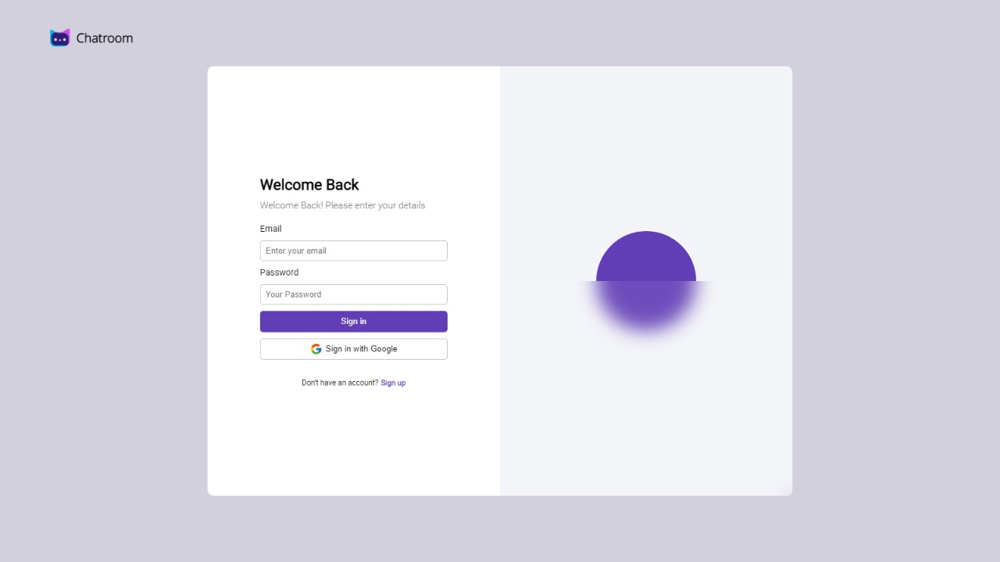
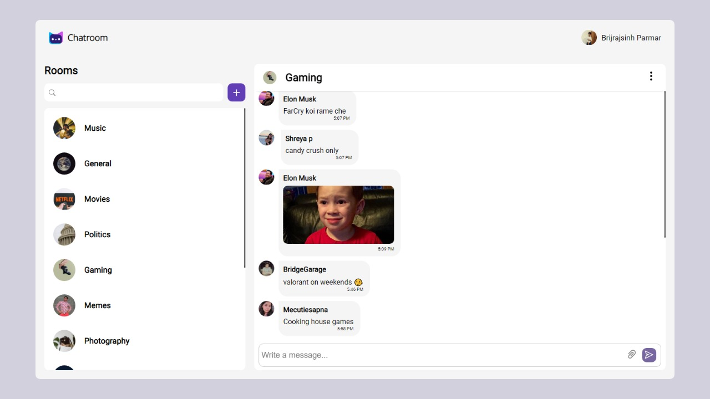
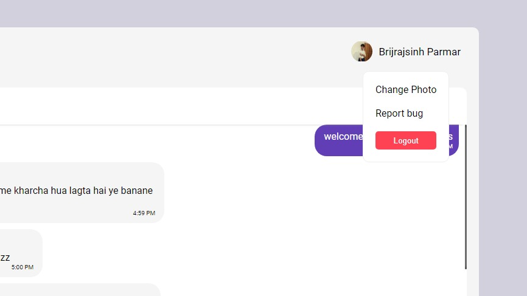
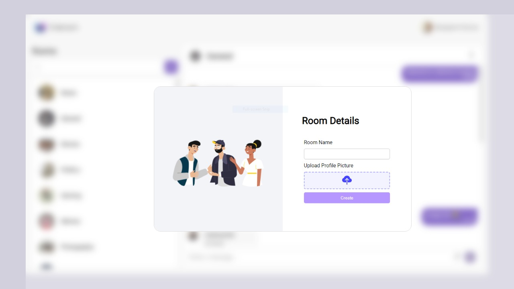

# 🚀 ChatRoom V3

<div align="center">
  
  
  [](https://reactjs.org/)
  [](https://firebase.google.com/)
  [](https://vitejs.dev/)
  [](LICENSE)
</div>

## ✨ Features

### 🎨 Modern & Minimal UI

- Clean, intuitive interface with smooth animations
- Responsive design that works on all devices
- Beautiful transitions and micro-interactions

### 💬 Rich Messaging

- Real-time text messaging
- Image sharing with automatic compression
- Message history and persistence
- Read receipts and typing indicators

### 👥 Community Features

- Create and join custom chat rooms
- Search and discover communities
- Profile customization with display pictures
- User-friendly group management

## 🖼️ Gallery

<div align="center">
  
  
  
  
</div>

## 🛠️ Tech Stack

- **Frontend Framework:** React 18
- **Build Tool:** Vite
- **Backend & Database:** Firebase
- **UI/UX:** Framer Motion
- **Icons:** React Icons
- **Image Processing:** Browser Image Compression

## 🚀 Getting Started

### Prerequisites

- Node.js (Latest LTS version recommended)
- npm or yarn

### Installation

1. Clone the repository

```bash
git clone https://github.com/brijrajparmar27/Chatroom-V3.git
cd Chatroom-V3
```

2. Install dependencies

```bash
npm install
```

3. Start the development server

```bash
npm run dev
```

4. Build for production

```bash
npm run build
```

## 🌐 Live Demo

Visit the live application at [chatroom3.surge.sh](https://chatroom3.surge.sh/)

## 🤝 Contributing

Contributions, issues, and feature requests are welcome! Feel free to check the [issues page](https://github.com/brijrajparmar27/Chatroom-V3/issues).

## 📝 License

This project is licensed under the MIT License - see the [LICENSE](LICENSE) file for details.

## 👨‍💻 Author

**Brijrajsinh Parmar**

- GitHub: [@brijrajparmar27](https://github.com/brijrajparmar27)

---

<div align="center">
  Made with ❤️ by Brijrajsinh Parmar
  
  [Report Bug](https://github.com/brijrajparmar27/Chatroom-V3/issues) · [Request Feature](https://github.com/brijrajparmar27/Chatroom-V3/issues)
</div>
